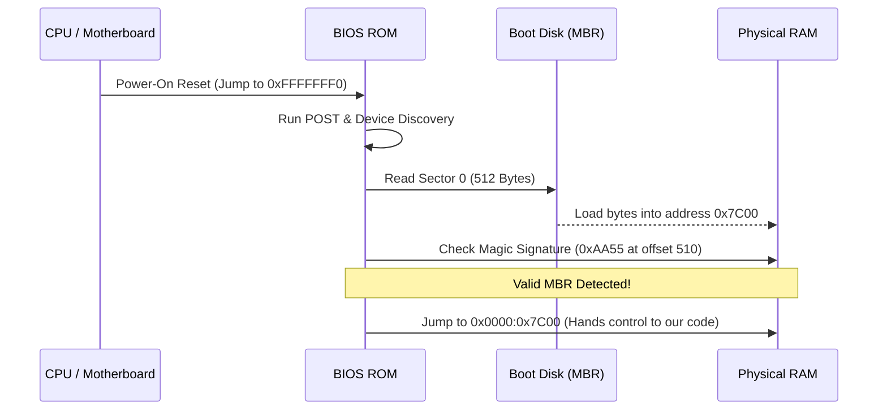
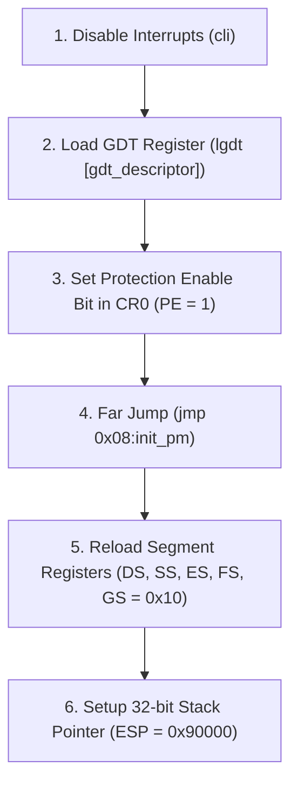
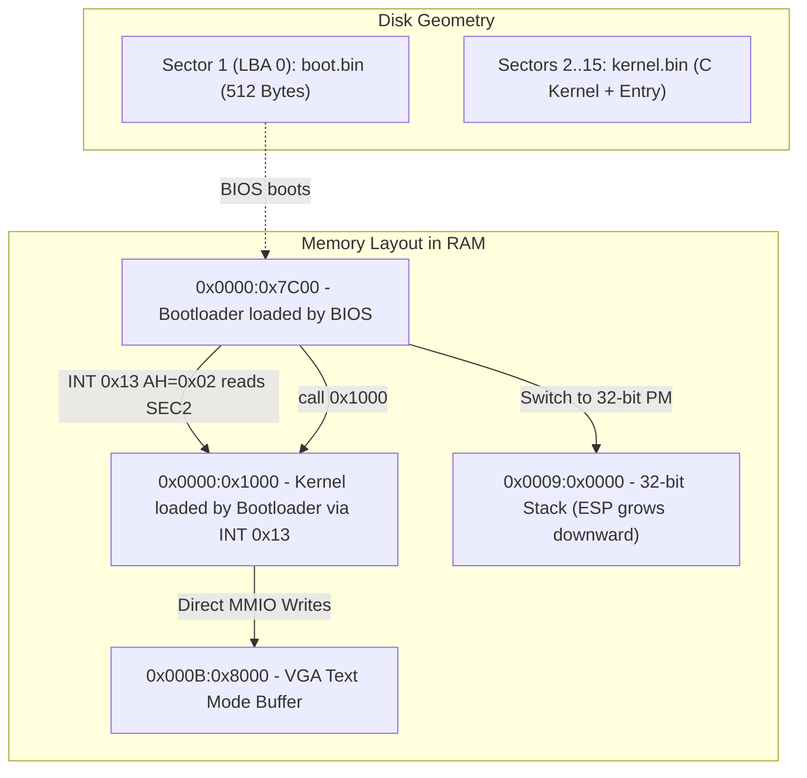
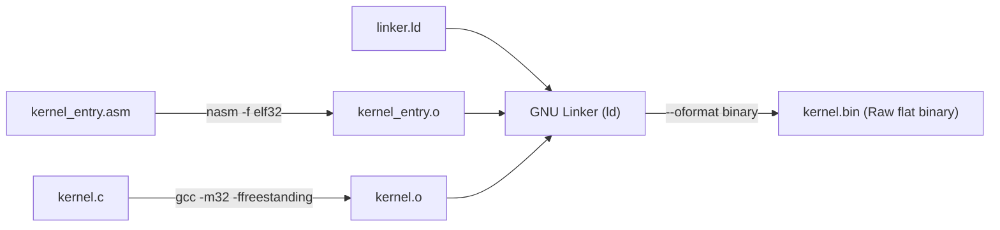

# Bare-Metal OS Development from Scratch: Architectural Notes & System Flow

---

## 1. Core Philosophy: Bare-Metal vs Hosted Systems

In standard software engineering, code runs in a **Hosted Environment**:
* The OS kernel sets up virtual memory, task scheduling, and loads dynamic libraries (`glibc`).
* Programs begin execution at `main(argc, argv)` with standard libraries (`<stdio.h>`, `<stdlib.h>`).

In **Bare-Metal Operating System Development**, there is no host:
* We write **Freestanding C** (`-ffreestanding -nostdlib`) and raw x86 assembly.
* The CPU executes raw machine opcodes directly on physical silicon.
* There is no runtime memory management, no standard library, and no standard I/O until we implement them ourselves.

```mermaid
flowchart LR
    subgraph Hosted Environment (Standard App)
        APP["Application (main)"] --> LIBC["glibc / stdlib"]
        LIBC --> KERNEL["Linux / Windows Kernel"]
        KERNEL --> HW["Physical Hardware"]
    end

    subgraph Bare-Metal Environment (Our OS)
        OUR_C["Our C Kernel (kernel_main)"] --> TRAMP["Assembly Entry (_start)"]
        TRAMP --> BOOT["Custom Bootloader (0x7C00)"]
        BOOT --> HW2["Physical Hardware"]
    end
```

---

## 2. Phase 1: BIOS Boot Protocol & 16-bit Real Mode

### 2.1 The Power-On Sequence
1. **Power-On Reset (POR):** The CPU powers on with registers initialized to hardware defaults.
2. **Reset Vector:** The Program Counter points to physical address `0xFFFFFFF0` (top of 4GB address space mapped to motherboard ROM).
3. **POST (Power-On Self-Test):** Motherboard firmware checks RAM, keyboard, bus topology, and storage drives.
4. **Boot Sector Hunt:** The BIOS searches configured boot devices for **Sector 0** (Master Boot Record).



### 2.2 The Geometry of an MBR Boot Sector
A boot sector is strictly **512 bytes**:
* **Bytes 0–445:** Boot code (executable instructions).
* **Bytes 446–509:** Partition table entries (4 entries of 16 bytes each).
* **Bytes 510–511:** The Magic Signature `0x55` and `0xAA` (as a 16-bit little-endian word: `0xAA55`).

### 2.3 Why Memory Address `0x7C00`?
In 1981, the designers of the IBM 5150 chose `0x7C00`:
* Minimum baseline RAM was 32 KB (`0x0000` to `0x7FFF`).
* They wanted the bootloader placed near the very top of conventional RAM to leave as much contiguous low memory free as possible for the loaded operating system.
* Subtracting 1 KB (512 bytes for bootloader code + 512 bytes for stack/scratchpad) from `0x8000` (32 KB) yields `0x7C00`.

### 2.4 The Real Mode Memory Model
* **Bit Width:** 16-bit registers (`AX`, `BX`, `CX`, `DX`, `SI`, `DI`, `SP`, `BP`, `IP`).
* **Address Space:** 1 Megabyte (`0x00000` to `0xFFFFF`).
* **Segmented Addressing Scheme:**
  $$\text{Physical Address} = (\text{Segment} \times 16) + \text{Offset}$$
* **BIOS Interrupts:** Handled via the **Interrupt Vector Table (IVT)** at physical addresses `0x0000..0x03FF`:
  * `INT 0x10`: Video services (Teletype mode `AH=0x0E`).
  * `INT 0x13`: Low-level disk services (Sector read `AH=0x02`).

---

## 3. Phase 2: Transitioning to 32-bit Protected Mode

### 3.1 Why Leave Real Mode?
1. **Memory Addressing:** Real Mode is locked to 1 MB. Protected Mode enables flat 32-bit addressing up to **4 Gigabytes**.
2. **Memory Safety & Privileges:** Real Mode has no memory protection; any instruction can wipe interrupt tables. Protected Mode introduces **Privilege Rings** (Ring 0 Kernel to Ring 3 User).
3. **Compiler Compatibility:** Modern C compilers (GCC) output 32-bit/64-bit flat memory instructions; they cannot target 16-bit segmented Real Mode.

### 3.2 The Global Descriptor Table (GDT)
In Protected Mode, segment registers (`CS`, `DS`, `SS`, `ES`) no longer hold base addresses. Instead, they hold **Segment Selectors** (byte offsets into the GDT).

```text
 63       56 55  52 51  48 47       40 39        16 15         0
+-----------+------+------+-----------+------------+------------+
| Base 31:24|Flags |Limit |Access Byte| Base 23:0  | Limit 15:0 |
|  (1 byte) |(4bit)| 19:16|(1 byte)   | (3 bytes)  | (2 bytes)  |
+-----------+------+------+-----------+------------+------------+
```

Our GDT creates a **Flat Memory Model** where Code and Data segments span the entire 4 GB address space:
* **Entry 0 (Offset `0x00`): Null Descriptor** (8 zero bytes required by CPU architecture).
* **Entry 1 (Offset `0x08`): Code Segment Descriptor** (Base = `0x0`, Limit = `0xFFFFF`, Granularity = 4KB, 32-bit, Executable, Readable, Ring 0).
* **Entry 2 (Offset `0x10`): Data Segment Descriptor** (Base = `0x0`, Limit = `0xFFFFF`, Granularity = 4KB, 32-bit, Writable, Ring 0).

### 3.3 The 4-Step Protected Mode Switch Sequence



#### Why Each Action is Necessary:
1. **`cli`:** 16-bit BIOS interrupt handlers will crash if triggered in 32-bit mode.
2. **`lgdt`:** Tells the CPU where the descriptor table resides in RAM and its limit.
3. **`CR0` Bit 0:** The hardware switch that toggles the CPU into 32-bit execution mode.
4. **The Far Jump:** The CPU instruction prefetch queue contains decoded 16-bit instructions. A far jump flushes the pipeline and forces `CS` to reload with selector `0x08`.
5. **Reloading Segments:** General segment registers retain invalid 16-bit limits until explicitly refreshed with the data selector (`0x10`).

---

## 4. Phase 3: Bare-Metal Display Mechanics (VGA Text Buffer)

Once in Protected Mode, BIOS `INT 0x10` is gone. Video output is achieved by writing directly to **Memory-Mapped I/O (MMIO)** at physical address **`0xB8000`**.

### 4.1 Screen Geometry
* **Dimensions:** 80 columns $\times$ 25 rows = 2,000 character cells.
* **Cell Size:** Exactly 2 bytes per cell (Total buffer size = 4,000 bytes).

```text
Cell Memory Layout:
Byte 0: ASCII Character Code (e.g., 'A' = 0x41)
Byte 1: Color Attribute Byte
        Bit 7:    Blink / Bright background
        Bit 6..4: Background Color (0-7)
        Bit 3..0: Foreground Color (0-15)
```

### 4.2 Linear Address Calculation
To write a character at grid coordinate $(x, y)$:
$$\text{Memory Offset} = 2 \times (y \times 80 + x)$$

---

## 5. Phase 4: Disk Loading & Multi-Stage Bootloader Architecture

Because an MBR is limited to 512 bytes, operating systems use a **multi-stage architecture**:



### BIOS Disk Reading Parameters (`INT 0x13, AH=0x02`):
* `AH = 0x02` (Read Sectors)
* `AL = 0x0E` (Number of sectors to read: 14 sectors)
* `CH = 0` (Cylinder 0)
* `CL = 2` (Sector 2: BIOS sectors are 1-indexed)
* `DH = 0` (Head 0)
* `DL = Drive Number` (Passed by BIOS in `DL` upon power-on)
* `ES:BX = 0x0000:0x1000` (Destination RAM pointer)

---

## 6. Phase 5: Freestanding C & Linker Scripts

### 6.1 The Compilation Pipeline


### 6.2 The Purpose of `kernel_entry.asm`
C compilers do not guarantee that the entry function (`kernel_main`) is placed at byte 0 of the generated code section. 
The assembly trampoline guarantees execution enters `_start` at byte 0 and issues a standardized `call kernel_main`.

### 6.3 Linker Script Architecture (`linker.ld`)
* **`ENTRY(_start)`:** Sets the execution entry symbol.
* **`. = 0x1000;`:** Location counter. Enforces that all internal pointers, jump targets, and memory references are resolved relative to `0x1000`.
* **Section Sequencing:**
  * `.text`: Executable code (with `kernel_entry.o` placed first).
  * `.rodata`: Constant strings and read-only tables.
  * `.data`: Initialized global variables.
  * `.bss`: Zero-initialized / uninitialized variables.
* **`ALIGN(4)`:** Enforces 32-bit word alignment on memory boundaries for optimal CPU bus access.

---

## 7. Real Hardware vs Virtual Machine (Troubleshooting & Quirks)

Developing for real physical silicon revealed several critical architectural lessons:

| Symptom / Trap | Root Cause | Engineering Solution |
| :--- | :--- | :--- |
| **Triple Fault on Real AMD Hardware** | Some physical BIOSes initialize with dirty segment registers (`CS = 0x07C0`, `DS != 0`). Addressing `[gdt_descriptor]` loaded garbage RAM. | Perform a far jump `jmp 0x0000:start` to normalize `CS`, followed by `xor ax, ax; mov ds, ax; mov es, ax; mov ss, ax`. |
| **CPU Runaway / Fan Overheating** | `jmp $` runs in an infinite 100% busy-loop on physical CPU cores. | Use `cli` followed by a halted loop: `.hang: hlt; jmp .hang` to place the CPU core in low-power idle. |
| **BIOS End-of-Disk Error on `INT 0x13`** | Reading 14 sectors from an image smaller than 7.5 KB causes the disk controller to return an out-of-bounds error. | Pad `os-image.bin` with `truncate -s 64K` to guarantee disk geometry depth. |
| **Modern NVMe / eDP Limitations** | Modern laptop UEFI firmware lacks legacy `INT 0x13` Option ROMs for PCIe NVMe drives, and eDP internal displays do not route physical `0xB8000` VGA MMIO. | Chainload via GRUB or use VESA Linear Framebuffers (LFB) for graphical display output. |

---

## 8. Summary of Project Map

```text
OSfromScratch/
├── boot/
│   ├── boot.asm           # 16-bit MBR, disk reader, 32-bit switch, far jump
│   └── gdt.asm            # GDT null, code, data descriptors & GDTR structure
├── kernel/
│   ├── kernel_entry.asm   # 32-bit trampoline calling kernel_main
│   └── kernel.c           # Freestanding C entry point & screen loop
├── include/
│   └── types.h            # Bare-metal fixed-width types (uint8_t, size_t, NULL)
├── linker.ld              # Memory layout linking code at 0x1000
├── Makefile               # Automated compilation, disk assembly & QEMU launcher
├── run                    # Executable launcher script
└── Working.md             # Architectural documentation & study notes
```
